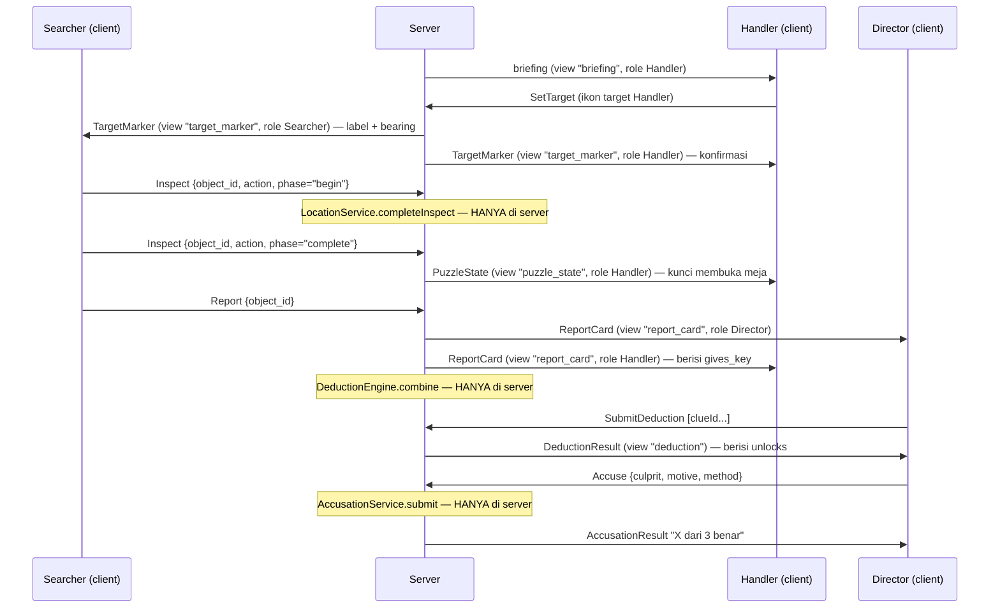

# Arsitektur teknis Triangulate

Dokumen ini menjelaskan arsitektur yang **sudah ada di repo ini** (scaffold
minggu 0, EXTA-32), bukan arsitektur yang dicita-citakan. Setiap klaim membawa
nomor bagian PRD atau URL sumber primer. Yang tidak bisa saya buktikan ditandai
`ASUMSI` atau masuk ke bagian "Belum terbukti".

Basis: PRD v0.2 (`docs/prd-v0.2.md`), §15 "Persyaratan Teknis" dan §17 "Roadmap".

---

## 1. Prinsip yang mengunci seluruh desain

PRD §15 baris pertama: *"Server menyimpan state kasus dan solusi. Client hanya
menerima data sesuai role. Pemeriksaan resep deduksi dan tuduhan hanya di
server."*

Tiga kalimat itu adalah tiga aturan berbeda, dan masing-masing butuh mekanisme
sendiri:

| Aturan PRD §15 | Mekanisme di repo |
|---|---|
| Server menyimpan state kasus dan solusi | Data kasus hidup di `ServerStorage.Cases`; solusi yang terpilih tidak pernah meninggalkan server |
| Client hanya menerima data sesuai role | `shared/Net.luau` — proyeksi whitelist per (view, role) |
| Pemeriksaan resep deduksi dan tuduhan hanya di server | `DeductionEngine.combine` dan `AccusationService.submit` hanya dipanggil dari `init.server.luau` |

Landasan otoritasnya, dari dokumentasi Roblox:

- *"The Roblox server is the ultimate authority for maintaining the game's state"*
  — https://create.roblox.com/docs/projects/client-server
- *"Never trust the client"*; *"The server must be the ultimate source of truth
  for all simulation states, rules, player progression, and critical decisions."*
  — https://create.roblox.com/docs/scripting/security/security-tactics
- *"Every piece of data sent from a client must be validated by the server before
  it's used."* — https://create.roblox.com/docs/scripting/security/client-server-boundary

---

## 2. Peta repo

```
default.project.json        Rojo: memetakan src/ dan data/ ke pohon DataModel
.luaurc                     Luau: languageMode strict + daftar global Roblox
selene.toml  stylua.toml    Lint dan format
rokit.toml                  Pin versi toolchain

src/shared/                 Direplikasi ke client. TIDAK BOLEH berisi rahasia.
  Config.luau               Angka dari PRD (§5, §8, §12)
  Roles.luau                Tiga role, rotasi, prioritas keadilan (§3, §8, §10)
  Net.luau                  Kontrak remote + proyeksi per role (§15)
  PingPhrases.luau          Frasa ping wheel per role (§7)
  PuzzleTable.luau          Bentuk data meja puzzle (dipakai client dan server)
  case/CaseGraph.luau       Graf ketergantungan: ketersediaan per varian (§4)
  case/CaseLoader.luau      Memuat kasus dari data + seed
  case/CaseValidator.luau   Validator graf kasus (satu jalur, tanpa siklus)
  case/Compat.luau          Jembatan require lintas runtime (Roblox vs CLI)

src/server/                 ServerScriptService. Tidak pernah direplikasi.
  init.server.luau          Titik masuk: guard, remote, sesi, handler, lobby
  CaseSource.luau           Sumber data kasus: ServerStorage + bentuk + seam validator (§10)
  LocationService.luau      Lokasi: objek bisa diperiksa, mini-aksi, gerbang unlocks (§4, §6)
  ClueGraph.luau            Graf ketergantungan: ketersediaan, asiklik (§4)
  DeductionEngine.luau      Resep deduksi (§4)
  AccusationService.luau    Tuduhan, percobaan, rank (§5)
  AccusationGate.luau       Gerbang tuduhan, kontradiksi, cleanup, rekap (§5)
  PuzzleTableService.luau   Meja puzzle: pemasangan, progres (§4)
  RoleAssignment.luau       Penetapan role + prioritas keadilan (§8)
  Matchmaking.luau          Lobby, ready check, batas waktu (§8)
  NPCController.luau        Pengambilalihan AFK, aksi NPC (§8)
  TelemetryService.luau     Idle time, waktu ke clue pertama (§12, §15)

src/client/                 StarterPlayerScripts.
  init.client.luau          Titik masuk client
  NetClient.luau            Binding remote; tiap remote punya fungsi bernama
  Hud/init.luau             HUD: clue board, form tuduhan, rekap Cold Case
  Hud/PingWheel.luau        Ping wheel (§7)
  Table/init.luau           Meja puzzle top-down: drag-and-snap, kamera Scriptable (§4, §15)
  Location/init.luau        Interaksi objek Searcher: hold, periksa, Report (§4, §6)

data/cases/                 Di-mount ke ServerStorage.Cases
  gallery_01.json           Kasus contoh "Lukisan yang Tertukar" (§4)
  README.md                 Aturan data kasus (dibaca Rojo: diabaikan)

tests/                      Uji CLI via Lune (lihat §8)
```

### Kenapa `src/shared` dipisah dari `src/server`

Karena replikasi Roblox bersifat **all-or-nothing per instance**: *"Generally
speaking, an instance either replicates to all connected clients or does not."*
— https://create.roblox.com/docs/scripting/security/access-control

Konsekuensinya: apa pun yang ada di `ReplicatedStorage` **pasti** bisa dibaca
exploiter — *"Any content that replicates to a client can be extracted and
data-mined by an exploiter."* (sumber yang sama). Jadi `src/shared` hanya berisi
hal yang memang boleh publik: konstanta, nama role, daftar remote, daftar frasa
ping. Tidak ada solusi kasus, tidak ada resep deduksi, tidak ada peta mana
role tahu apa.

Sebaliknya, `ServerScriptService` *"never replicated to player clients at all"*
(https://create.roblox.com/docs/reference/engine/classes/ServerScriptService),
dan `ServerStorage` *"will not replicate to the client and will not be
accessible from LocalScripts"*
(https://create.roblox.com/docs/reference/engine/classes/ServerStorage).

---

## 3. Mekanisme tidak bocor: tiga lapis

PRD §18 mencantumkan risiko *"Exploit/bocor — Solusi & resep hanya di server"*
dan *"Spoiler — Cabang solusi per seed"*. Tiga lapis di bawah ini yang
menanganinya. Tiap lapis independen: kalau satu gagal, yang lain masih menahan.

### Lapis 1 — Container: data kasus tidak pernah direplikasi

`data/cases/` di-mount Rojo ke `ServerStorage.Cases`. Client tidak punya jalan
membacanya: bukan lewat `ReplicatedStorage`, bukan lewat `Workspace`, bukan
lewat atribut.

Ini penting karena **atribut Instance tidak bisa dipakai sebagai kanal rahasia
per-pemain**: atribut *"are replicated so that clients can access them
immediately"* — replikasinya global, bukan per-pemain.
(https://create.roblox.com/docs/studio/properties)

Kanal per-pemain yang tersedia secara native hanya dua, dan keduanya belum
dipakai di minggu 0:

- `PlayerGui` — UI per-pemain
  (https://create.roblox.com/docs/reference/engine/classes/PlayerGui);
- `Model` dengan `ModelStreamingMode.PersistentPerPlayer` +
  `Model:AddPersistentPlayer(player)` — objek dunia per-pemain
  (https://create.roblox.com/docs/workspace/streaming).

`ASUMSI`: kalau nanti ada kebutuhan menyiarkan objek dunia hanya ke satu role
(mis. pinpoint Director yang tidak boleh dilihat Searcher sebelum waktunya),
`PersistentPerPlayer` adalah jalur yang benar. Ini belum diuji dan belum
dipakai di kode mana pun.

### Lapis 2 — Kontrak: proyeksi whitelist per (view, role)

`shared/Net.luau` adalah satu-satunya tempat yang tahu field apa yang boleh
sampai ke role mana. Bentuknya **whitelist**, bukan blacklist:

```lua
Net.project(source, allowed)     -- menyalin HANYA nama field yang ada di `allowed`
Net.forRole(view, role, source)  -- pilih `allowed` dari CLIENT_VIEWS; nil bila view/role tak dikenal
```

Perhatikan `project` **tidak** mengembalikan `nil`: ia selalu mengembalikan
tabel. Yang bisa `nil` adalah `forRole`, dan `nil` di sana berarti "jangan
kirim", bukan "kirim kosong" — pemanggil harus memperlakukannya begitu.

Konsekuensi yang disengaja: menambah field baru ke data kasus **tidak**
membocorkannya, karena field itu tidak akan tersalin sampai seseorang
mendaftarkannya di `CLIENT_VIEWS`. Blacklist akan punya sifat sebaliknya — field
baru bocor secara default sampai seseorang ingat memblokirnya.

`Net.SECRET_FIELDS` (9 nama) adalah daftar yang **diuji tidak boleh muncul** di
view mana pun. `Net.validateViews()` mengembalikan `(ok, daftarMasalah)`.

### Lapis 3 — Boot guard: start dibatalkan kalau kontrak bocor

Baris pertama di `init.server.luau` yang mengeksekusi logika — sebelum state
sesi, sebelum lobby, sebelum satu remote pun dibuat:

```lua
local viewsOk, viewProblems = Net.validateViews()
if not viewsOk then
    error("[Triangulate] Kontrak Net bocor, start dibatalkan: " .. table.concat(viewProblems, "; "))
end
```

Ini `error`, bukan `warn`. Alasannya: kontrak yang bocor adalah cacat yang tidak
bisa ditambal saat runtime, dan server yang jalan dengan kontrak bocor lebih
berbahaya daripada server yang tidak jalan sama sekali.

Bukti bahwa guard ini bukan hiasan: saat scaffold ini ditulis, satu view
Director memakai nama field `key_deductions`, yang bertabrakan dengan
`SECRET_FIELDS` (nama itu ada di daftar rahasia karena *deduksi mana yang kunci*
adalah informasi solusi). `validateViews()` menolak start. Field view-nya
diganti menjadi `key_deductions_required` — Director butuh **jumlah** gerbang
yang harus dibuka, bukan **yang mana** yang kunci. Guard menangkap ini sebelum
satu baris pun jalan.

### Yang tetap harus diingat

Tiga lapis di atas melindungi **data**, bukan **perilaku**. Exploiter masih bisa
mengirim remote dengan argumen palsu. Karena itu setiap handler di
`init.server.luau` memvalidasi ulang:

- `handleDeduce` menolak bila pengirim bukan Director, lalu memeriksa setiap
  elemen array adalah string sebelum menyerahkannya ke `DeductionEngine`;
- `handleAccuse` menolak bila pengirim bukan Director dan bila payload bukan
  tabel;
- `handleConfirm` menolak konfirmasi dari Director sendiri (PRD §5: konfirmasi
  harus dari role lain).

Yang **belum** ada: rate limiting. Dokumentasi Roblox menyebut *"never rely
solely on a client-sided rate limit"* dan menyediakan pola token bucket
(https://create.roblox.com/docs/scripting/security/client-server-boundary).
RemoteEvent dibatasi *"approximately 500 requests per second, per client"* dan
batas itu *"shared among all remote events of the same type"*
(https://create.roblox.com/docs/reference/engine/classes/RemoteEvent). Ini
utang yang harus dibayar sebelum rilis, bukan sebelum prototype — tetapi
mencatatnya di sini supaya tidak terlupakan.

---

## 4. Alur data satu rantai bukti

PRD §4 mendefinisikan graf ketergantungan empat jenis node. Alur runtime-nya:



Perhatikan `Inspect`: server mengirim `PuzzleState` ke **Handler**, bukan ke
Searcher yang memicunya. Kunci yang diberikan objek adalah informasi role lain
(PRD §1), jadi yang memeriksa objek tidak melihat apa yang terbuka karenanya.
`Net.forRole` yang melakukannya — bukan pemeriksaan di client.

`Report` tidak lagi membawa `location`. Nama lokasi dirangkai server dari
`session.location.location`, sehingga client tidak bisa memalsukan tag lokasi di
clue board Director. Lihat `docs/mvp-notes.md` §2.2 untuk apa yang diverifikasi
server dan apa yang belum.

Perhatikan panah `Srv->>H` dan `Srv->>D` pada langkah ReportCard: payload
sumbernya **satu objek yang sama**, tetapi `Net.forRole` memproyeksikannya
berbeda. Handler menerima `gives_key`; Searcher dan Director tidak. Ini yang
membuat "tiap role memegang informasi berbeda" (PRD §1) jadi properti
arsitektur, bukan sekadar niat desain.

### Tiga pemisahan informasi yang sudah nyata di kode

| Pemisahan | Di mana | PRD |
|---|---|---|
| Handler dapat kunci, role lain tidak | `CLIENT_VIEWS.report_card` | §4 |
| Director dapat jumlah gerbang deduksi, bukan deduksi mana yang kunci | `CLIENT_VIEWS.session_state.Director` | §5 |
| Briefing per role berbeda | `CLIENT_VIEWS.briefing` + `data/cases/*.json` `briefings` | §9 |
| `DeductionResult.unlocks` hanya berisi **id objek**, tidak pernah resepnya | `CLIENT_VIEWS.deduction` | §4, §5 |

Baris terakhir itu sengaja: id objek sudah terlihat sebagai nama part di
`Workspace`, jadi mengirimnya tidak menambah pengetahuan apa pun kepada client.
Yang tidak ikut terkirim adalah pasangan Clue Card yang membukanya — itulah
resepnya, dan resep hanya hidup di `DeductionEngine` di server.

---

## 5. Kenapa logika inti tidak menyentuh Roblox

Modul-modul ini **tidak** menyentuh satu pun global Roblox — tanpa `game`,
`Instance`, `UDim2`, `Player`:

`Config`, `Roles`, `Net`, `PingPhrases`, `PuzzleTable`, `LocationMap`,
`RoleAssignment`, `Matchmaking`, `AccusationService`, `AccusationGate`,
`DeductionEngine`, `ClueGraph`, `TelemetryService`, `NPCController`,
`PuzzleTableService`, `LocationService`, `CaseGraph`, `CaseValidator`, dan
`CaseLoader` (`src/shared/case/CaseLoader.luau` — `selectVariant`,
`projectForRole`, dan `load` seluruhnya murni; bagian yang menyentuh
`Instance` ada di `CaseSource.shapeProblems` dan `CaseSource.load`).

Konsekuensi praktisnya besar: **aturan permainan bisa diuji dari CLI, tanpa
Studio dan tanpa Roblox.** 1099 assertion berjalan dalam waktu di bawah satu
detik (`tests/run.luau`, 20 berkas spec). Untuk game yang aturan menang-kalahnya
serumit PRD §5 (tiga percobaan, gerbang N deduksi, kontradiksi wajib, rank
S/A/B/C), itu perbedaan antara "bisa diuji sambil ngopi" dan "harus buka Studio
tiap kali".

Pola yang dipakai untuk mencapai ini: **kebijakan masuk sebagai argumen, bukan
sebagai `require`.** Contoh konkret:

- `CaseSource.load(casesFolder, caseId)` menerima folder, tidak memanggil
  `game:GetService("ServerStorage")`.
- `LocationService.new(opts)` menerima `nodes`, `reachableIds`, dan `clock`,
  tidak membacanya dari global.
- `AccusationService.newSession(solution, fields, maxAttempts)` menerima angka,
  tidak `require` `Config`.
- `AccusationGate.newSession(config, gateFn, now)` menerima aturan gerbang dan
  jam sebagai argumen, jadi seluruh siklus tuduhan — gerbang, kontradiksi,
  penalti cleanup, rekap — bisa dijalankan dari CLI.
- `Matchmaking.join(lobby, player, config)` menerima config, tidak membacanya
  dari global.

Kalau salah satu modul itu `require` `Config` yang menyentuh `game`, seluruh
rantai uji CLI mati. Jadi aturan ini bukan gaya — ini yang menjaga suite tetap
bisa jalan.

---

## 6. RemoteEvent: dibuat kode, bukan Rojo

`init.server.luau` membuat seluruh 22 RemoteEvent dari satu sumber:
`Net.REMOTE_NAMES`. Tidak ada remote di `default.project.json`.

Alasannya: kalau remote didefinisikan dua kali (sekali di file project, sekali
di kode), keduanya bisa berbeda dan perbedaannya baru ketahuan saat runtime.
Dengan satu sumber, daftar remote tidak bisa menyimpang dari kontrak datanya.

Client **menunggu** remote itu muncul, tidak membuatnya sendiri:
`NetClient.bind` memakai `WaitForChild`. Dokumentasi Roblox menegaskan kenapa
harus begitu: *"The Roblox Engine doesn't guarantee the order in which objects
(and changes to objects) are replicated from the server to the client, which
makes the Instance:WaitForChild() method essential for accessing objects in
client scripts"* (https://create.roblox.com/docs/scripting/attributes).

Pembagiannya:

| Arah | Jumlah | Nama |
|---|---|---|
| Server → client | 12 | `SessionState`, `ClueCard`, `TargetMarker`, `Pinpoint`, `ReportCard`, `AccusationResult`, `DeductionResult`, `PuzzleState`, `PiecePlaced`, `PingRelay`, `ContradictionResult`, `TablePreview` |
| Client → server | 10 | `Report`, `SubmitDeduction`, `Accuse`, `Ping`, `SetTarget`, `RequestHint`, `ConfirmAccusation`, `PlacePiece`, `MarkContradiction`, `Inspect` |

`PingRelay`, `SetTarget`, `ContradictionResult`, dan `TablePreview` adalah
remote minggu 3 dan minggu 6. Semuanya ada karena `tests/net.spec.luau`
menegaskan setiap remote punya **tepat satu** arah:

- `PingRelay` (server → client) dipisah dari `Ping` (client → server) supaya
  frasa ping tidak perlu membuat satu remote dua arah.
- `SetTarget` (client → server) ada karena PRD §7 menjadikan Target Marker
  aksi **Handler**, jadi harus berangkat dari client; server meneruskannya ke
  Searcher lewat `TargetMarker`.
- `MarkContradiction` (client → server) dan `ContradictionResult`
  (server → client) dipisah karena hasilnya harus membawa **alasan** yang bisa
  dibaca pemain (PRD §4), bukan sekadar diterima/ditolak.
- `TablePreview` (server → client) memberi Director progres meja Handler
  (PRD §7) tanpa memakai `PuzzleState`, yang membawa potongan dan tidak
  seharusnya sampai ke Director.

`MarkContradiction` (client → server) adalah remote minggu 4: PRD §4
menjadikan penandaan Kontradiksi aksi **Director**, dan hanya Director yang
memegang pernyataan saksi. Server memeriksa ulang kecocokan terhadap
`contradicted_by` sebelum menerimanya — client tidak dipercaya.

`Inspect` (client → server) adalah remote minggu 2 dari rantai bukti
(PRD §4, §6). Searcher memeriksa objek di lokasi; server memutuskan apakah
objek itu boleh diperiksa (`LocationService.isInspectable`), memberi kunci,
dan mengirim meja yang terbuka lewat `PuzzleState`. Yang menentukan hasil
pemeriksaan selalu server, bukan client.

`NetClient` sengaja tidak menyediakan pengiriman payload bebas: tiap remote
punya fungsi bernama (`NetClient.report`, `NetClient.deduce`, `NetClient.accuse`,
…), sehingga di code review terlihat persis data apa yang meninggalkan client.
`NetClient.report(bound, objectId)` hanya mengirim `object_id` — lokasi yang
tampil di clue board Director **diturunkan server** dari data kasus, tidak
dipercaya dari client.

Catatan urutan: RemoteEvent *"arrive in the order you fire them, including
across different RemoteEvent instances"*, tetapi RemoteFunction dan RemoteEvent
**tidak** dijamin berurutan relatif satu sama lain
(https://create.roblox.com/docs/scripting/events/remote). Repo ini hanya
memakai RemoteEvent, jadi tidak ada masalah urutan lintas tipe — dan itu
disengaja.

---

## 7. Matchmaking dan role: apa yang nyata, apa yang belum

Yang **sudah nyata** dan teruji:

- `RoleAssignment.assign` menghormati dua preferensi role (PRD §3, §8) dan
  memakai prioritas keadilan: pemain yang memegang role sama 3 sesi berturut-turut
  (PRD §8) diprioritaskan ke preferensi berikutnya. `Roles.FAIRNESS_STREAK = 3`.
- Pemain baru tidak otomatis jadi Director
  (`Roles.NEW_PLAYER_EXCLUDED_ROLE`), sesuai PRD §8: *"Pemain baru tidak
  otomatis jadi Director di sesi pertama."*
- Rotasi otomatis private/seri kasus: `RoleAssignment.rotate` dengan urutan
  `Roles.ROTATION` = Searcher → Handler → Director → Searcher (PRD §10).
- `Matchmaking.rolesWithoutHumans` dan `NPCController.rolesToFill` menghitung
  role yang perlu diisi NPC. Keduanya menjawab pertanyaan berbeda dan bedanya
  penting: yang pertama "tidak ada manusia", yang kedua "benar-benar diisi NPC".
  Pada MVP Director **tidak** masuk daftar kedua, karena NPC Director adalah P1
  (PRD §8 tabel prioritas NPC, §16).

Yang **belum terpasang**, dan alasannya:

PRD §17 menempatkan *"Lobby, preferensi role, NPC, AFK/rejoin"* di **minggu 5**.
Scaffold minggu 0 memakai jalur sederhana: sesi mulai saat 3 pemain sudah ada.

| Belum | Modul yang sudah siap | Kenapa ditunda |
|---|---|---|
| Timer lobby 45/90 detik | `Matchmaking.deadline`, `secondsLeft` | Butuh penjadwal (`task.delay`); minggu 5 |
| Ready check 10 detik | `Matchmaking.readyFailures`, `canStart` | Butuh UI yang menyetel `ready`; minggu 5 |
| Preferensi role dari pemain | `RoleAssignment.assign` | `preferences` masih `Roles.ALL` = "tanpa preferensi"; butuh layar lobby; minggu 5 |
| Perilaku NPC | `NPCController.nextAction`, `rolesToFill` | Loop game; minggu 5 |
| AFK takeover & rejoin | `NPCController.shouldTakeOver`, `shouldReleaseSlot` | Butuh deteksi input; minggu 5 |

Yang **sudah dilakukan** meski NPC-nya belum ada: `startSession` mencatat role
mana yang diisi NPC dan **memperingatkan** role yang kosong tetapi tidak boleh
diisi NPC pada MVP. Jadi minggu 5 menambah pelaku, bukan mencari tahu role mana
yang kosong.

### Satu hal yang tidak bisa dikerjakan dari kode

PRD §15: `MaxPlayers = 3`. `Players.MaxPlayers` **tidak bisa disetel dari
script**: *"This property can only be set through a specific place's settings on
the Creator Dashboard."*
(https://create.roblox.com/docs/reference/engine/classes/Players)

`init.server.luau` karena itu hanya bisa **memverifikasi** dan memperingatkan.
Setelannya ada di Creator Dashboard: **Configure ⟩ Places ⟩** pilih place **⟩
tab Access ⟩ Maximum Visitor Count**
(https://create.roblox.com/docs/chat/voice-chat, yang mendokumentasikan label
UI-nya). Ini pekerjaan manusia, bukan pekerjaan kode.

---

## 8. Verifikasi: apa yang sudah dibuktikan, dan apa yang tidak

Semua perintah dijalankan dari akar repo.

### Sudah dibuktikan

Semua perintah di bawah dijalankan pada hasil integrasi EXTA-55 + EXTA-56 ke
`main` (`830fe1a` + `b3fa556`), 2026-10-05, dengan perintah yang **sama persis**
dengan `.github/workflows/ci.yml`.

| Perintah | Hasil |
|---|---|
| `lune run tests/run.luau` | **1099 assertion, 0 gagal** — 20 berkas spec |
| `selene --config selene.toml .` | **0 errors, 0 warnings, 0 parse errors** |
| `stylua --config-path stylua.toml --check .` | **bersih** (exit 0) |
| `luau-analyze --mode=strict` atas 19 modul murni | **0 diagnostik** |
| `rojo build -o build.rbxlx` | **berhasil** — 377.689 byte |
| `lune run tools/validate_case.luau -- data/cases/*.json` | **LULUS** — 3 berkas, 0 errors, 0 warnings |
| `lune run tools/bukti-rantai-a.luau` | **LULUS** — rantai A → bukti jalan end to end, 0 pemeriksaan gagal |

Tabel ini dulu mencantumkan 358 assertion dan `selene src tests`; keduanya
usang. Baris `stylua` juga berubah: `main` pra-integrasi menyisakan enam berkas
yang gagal `--check` (`init.server.luau` + lima spec). Branch EXTA-56 sudah
bersih, dan resolusi gabungan ini memformat tiga berkas yang tersisa
(`init.server.luau`, `AccusationGate.luau`, `tests/accusation-gate.spec.luau`),
jadi seluruh pohon kini bersih.

Hasil `rojo build` juga diperiksa isinya, bukan cuma status keluarnya. Pohon
yang dihasilkan dari `default.project.json`:

```
ReplicatedStorage.Shared          Folder
  Config, LocationMap, Net, PingPhrases, PuzzleTable, Roles   ModuleScript
  case/                            Folder
    CaseGraph, CaseLoader, CaseValidator, Compat  ModuleScript
ServerScriptService.Server         Script (11 ModuleScript anak)
  AccusationGate, AccusationService, CaseSource, ClueGraph, DeductionEngine,
  LocationService, Matchmaking, NPCController, PuzzleTableService,
  RoleAssignment, TelemetryService
ServerStorage.Cases                Folder
  case_00, gallery_01, kersana_01  ModuleScript
StarterPlayer.StarterPlayerScripts.Client  LocalScript
  Board, Hud/ (PingWheel), Location, NetClient, Table   ModuleScript
```

Total 30 `ModuleScript`, 1 `Script`, 1 `LocalScript`, 3 `Folder`. Tidak ada
`rbxassetid` nyata di pohon ini: `Table.SHEET` masih `rbxassetid://0`, jadi
place ini tidak akan menampilkan gambar puzzle sampai sheet-nya diunggah.

### Batas verifikasi yang harus dinyatakan jujur

**`luau-analyze` yang berdiri sendiri tidak punya definisi API Roblox.** Ia
mendukung `--mode`, `--formatter`, `--solver`, `--timetrace`, `--annotate` —
tetapi **bukan** `--definitions`. Jadi modul yang menyentuh `Instance`,
`UDim2`, `Player`, atau `RemoteEvent` akan selalu melaporkan `Unknown type`
dan `Unknown global`, bukan karena kodenya salah, tetapi karena tipe itu tidak
ada di binary-nya.

Karena itu batasnya saya nyatakan eksplisit: **19 modul murni bersih di bawah
`--mode=strict`; sisanya (`init.server.luau`, `init.client.luau`, `NetClient`,
`Hud/*`, `Table/*`, `Board/*`, `Location/*`, `CaseSource`) tidak bisa diperiksa
tipe oleh binary ini.** `shared/case/Compat.luau` juga
tidak dihitung: ia ditandai `--!nocheck`, jadi "lulus" di sana bukan hasil
pemeriksaan. Untuk modul yang menyentuh API Roblox dibutuhkan `luau-lsp` dengan
`sourcemap.json` dari `rojo sourcemap` — dan itu bagian dari EXTA-34 (CI/CD),
bukan scaffold ini.

**`rojo build` membuktikan struktur, bukan perilaku.** Tidak ada Roblox runtime
di lingkungan ini, jadi tidak ada satu pun baris `init.server.luau` yang pernah
dieksekusi. Yang bisa saya klaim: berkasnya parse bersih, tipenya konsisten di
bagian murni, dan strukturnya benar setelah dibangun. Yang tidak bisa saya
klaim: bahwa sesi 3 pemain berjalan.

### Yang tidak dijalankan sama sekali

Playtest Roblox Studio. Lingkungan ini tidak punya Studio, tidak punya akun
Roblox, dan tidak bisa `rojo serve` ke Studio. Semua verifikasi di atas adalah
verifikasi statis dan verifikasi logika murni.

Catatan tambahan untuk minggu 5: **API teleport tidak bekerja di playtest
Studio** — *"Note that this service does not work during playtesting in Roblox
Studio; to test aspects of your experience using it, you must publish the
experience and play it in the Roblox application."*
(https://create.roblox.com/docs/reference/engine/classes/TeleportService).
Jadi uji reserved server (PRD §15) butuh place yang sudah dipublikasikan.

---

## 9. Utang teknis, berurutan menurut risiko

| # | Utang | Risiko kalau dibiarkan | Kapan |
|---|---|---|---|
| 1 | Tidak ada rate limiting remote | Client bisa spam `Report`/`SubmitDeduction`/`MarkContradiction`; throttle platform ~500 req/s dibagi lintas remote bertipe sama | Sebelum rilis |
| 2 | `Players.MaxPlayers` hanya diverifikasi, tidak dipaksa | Place dengan MaxPlayers ≠ 3 bisa jalan | Sebelum playtest |
| 3 | Lobby minggu 5 belum ada (§7) | Sesi hanya mulai dengan 3 manusia; NPC tidak jalan | Minggu 5 |
| 4 | `luau-lsp` + `sourcemap.json` belum di CI | Regresi tipe di modul Roblox-facing tidak tertangkap otomatis | EXTA-34 |
| 5 | Telemetri dihitung tapi tidak dikirim | PRD §12 tidak bisa diukur | EXTA-34 |
| 6 | Belum ada `RemoteFunction` untuk permintaan balasan | Belum dibutuhkan; hindari `InvokeClient` (server bisa yield selamanya) | Kalau perlu |
| 7 | Remote `TargetMarker` belum pernah ditembakkan | Handler tidak bisa menandai target untuk Searcher (PRD §7) — butuh UI Handler | Minggu 4 |
| 8 | Pinpoint baru sampai ke client sebagai chip di peta Director, bukan marker di dunia | Searcher tidak melihat marka di lokasi (PRD §7) — data kasus belum punya koordinat dunia | Minggu 4 |

Untuk nomor 6, peringatannya verbatim dari dokumentasi: `InvokeClient` — *"If
the client doesn't return a value, the server yields forever."*
(https://create.roblox.com/docs/scripting/events/remote). Arsitektur ini sengaja
memakai RemoteEvent satu arah untuk semuanya.

---

## 10. Sumber

Dokumen dan bagian PRD:

- `docs/prd-v0.2.md` §1, §3, §4, §5, §7, §8, §9, §10, §12, §15, §16, §17, §18

Dokumentasi Roblox (semua diakses 2026-10-04):

- Server otoritatif: https://create.roblox.com/docs/projects/client-server
- Taktik keamanan: https://create.roblox.com/docs/scripting/security/security-tactics
- Batas client-server: https://create.roblox.com/docs/scripting/security/client-server-boundary
- Kontrol akses & replikasi: https://create.roblox.com/docs/scripting/security/access-control
- `ServerStorage`: https://create.roblox.com/docs/reference/engine/classes/ServerStorage
- `ServerScriptService`: https://create.roblox.com/docs/reference/engine/classes/ServerScriptService
- `ReplicatedStorage`: https://create.roblox.com/docs/reference/engine/classes/ReplicatedStorage
- `Players` (`MaxPlayers`): https://create.roblox.com/docs/reference/engine/classes/Players
- `RemoteEvent` (throttle): https://create.roblox.com/docs/reference/engine/classes/RemoteEvent
- Event remote (urutan, batasan argumen): https://create.roblox.com/docs/scripting/events/remote
- Atribut Instance: https://create.roblox.com/docs/studio/properties
- Streaming & `PersistentPerPlayer`: https://create.roblox.com/docs/workspace/streaming
- `PlayerGui`: https://create.roblox.com/docs/reference/engine/classes/PlayerGui
- `TeleportService` (deprecation, playtest): https://create.roblox.com/docs/reference/engine/classes/TeleportService
- Label UI "Maximum Visitor Count": https://create.roblox.com/docs/chat/voice-chat
